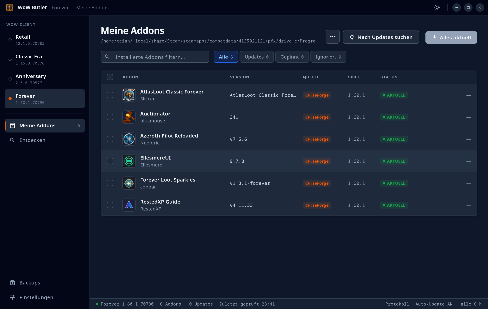
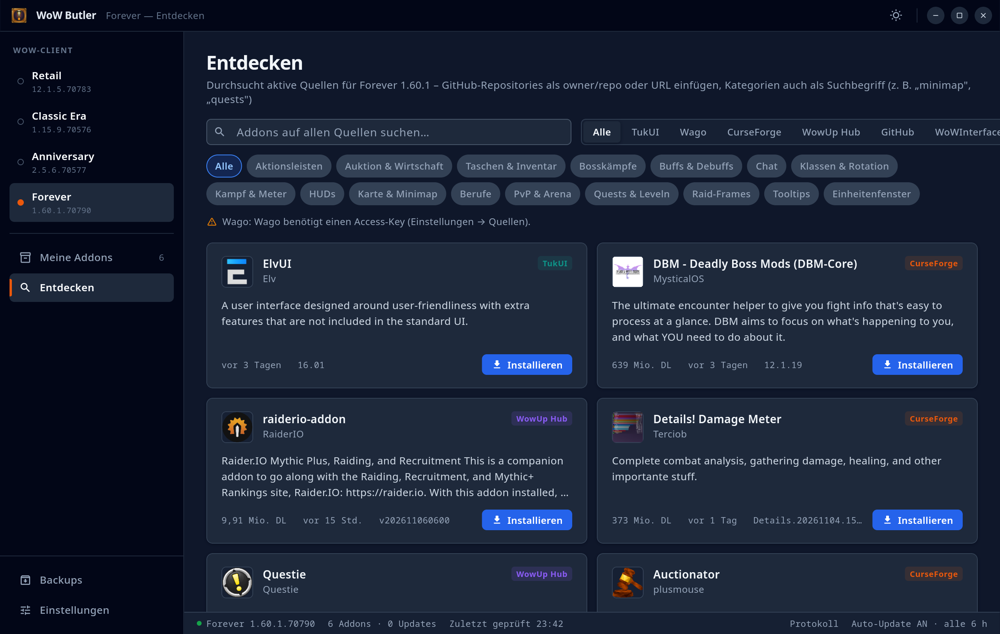
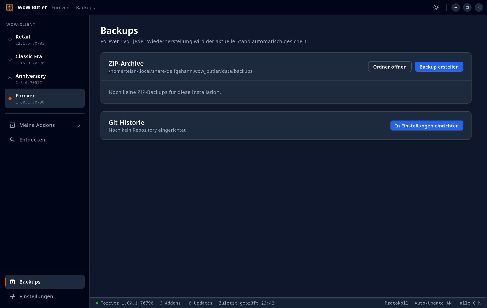
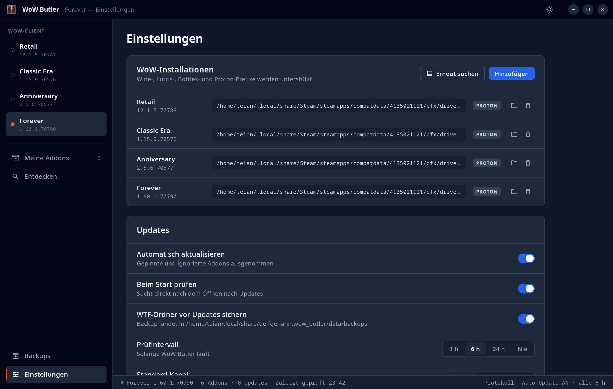

#  WoW Butler

Addon-Manager für World of Warcraft (Flutter, Linux/Windows/macOS) mit dem Funktionsumfang von WowUp.

## Screenshots



| Entdecken | Backups | Einstellungen |
| --- | --- | --- |
|  |  |  |

## Funktionen

- **Quellen:** CurseForge, Wago, WowUp Hub, TukUI (ElvUI/Tukui direkt), WoWInterface und GitHub-Releases, parallel durchsucht. Die Priorität beim Zuordnen ist einstellbar.
- **Erkennung installierter Addons:** über die Folder-Fingerprints von WowUp (Murmur2 für CurseForge, MD5 für Wago/WowUp Hub), TOC-IDs (`X-Curse-Project-ID`, `X-Wago-ID`, `X-WoWI-ID`) und TukUI-Metadaten. Nicht zugeordnete Addons lassen sich nachträglich manuell einer Quelle zuordnen.
- **Clients:** Retail, PTR/Beta, Classic (Mists), Classic Era, Anniversary und WoW Forever. Die Spielversion wird aus `.build.info` gelesen. Unter Linux werden Wine-, Lutris-, Bottles- und Steam-Proton-Prefixe automatisch gefunden.
- **Updates:** Kanäle Stable/Beta/Alpha pro Addon, Pinnen, Ignorieren, Auto-Update, Update-Warteschlange und Abhängigkeiten (CurseForge).
- **Backups:**
  - ZIP-Archive in einen frei wählbaren Ordner, periodisch mit Aufbewahrung. Ein neues Archiv entsteht nur, wenn sich die Daten geändert haben.
  - Vor Updates wird der WTF-Ordner gesichert.
  - Git-Repository mit Commit pro Sicherung, optionalem Push und Wiederherstellung aus der Historie. Aus einem gespeicherten Stand lassen sich Addons auch neu installieren.

## API-Schlüssel

CurseForge und Wago brauchen eigene Schlüssel. Sie werden unter **Einstellungen → Quellen** eingetragen.

- **CurseForge:** Schlüssel von https://console.curseforge.com
- **Wago:** Access-Key für Abonnenten
- **GitHub:** Ein Token ist optional und hebt das Rate-Limit an.

## Entwicklung

```bash
mise install          # Flutter-Version aus mise.toml
flutter pub get
flutter test
flutter run -d linux
```

Git-Backups benötigen ein installiertes `git`.

## Desktop-Builds

Release-Builds werden auf dem jeweiligen Betriebssystem erstellt. Voraussetzungen:
Flutter aus `mise.toml` und die native Toolchain (`flutter doctor`) – weitere
Werkzeuge sind nicht nötig, das Packaging läuft in Dart mit den Projektabhängigkeiten.

- **Linux:** Clang, CMake, Ninja, pkg-config und GTK-3-Entwicklungsbibliotheken.
- **Windows:** Visual Studio 2022 mit „Desktop development with C++“ und Windows SDK.
- **macOS:** Xcode und seine Command Line Tools; CocoaPods für Plugins, die es benötigen.

Auf dem jeweiligen System im Projektordner ausführen:

```bash
dart run tool/build_desktop.dart linux
dart run tool/build_desktop.dart windows
dart run tool/build_desktop.dart macos
```

Ohne Plattformargument wird das aktuelle Betriebssystem gewählt.
Mit `--skip-build` wird ein vorhandener Release-Build erneut verpackt.

Die Archive und SHA-256-Prüfsummen liegen in `dist/`:

| Plattform | Archiv | Start nach dem Entpacken |
| --- | --- | --- |
| Linux | `wow-butler-<version>-linux-<arch>.tar.gz` | `wow-butler/wow_butler` |
| Windows | `wow-butler-<version>-windows-<arch>.zip` | `wow-butler/wow_butler.exe` |
| macOS | `wow-butler-<version>-macos-<arch>.zip` | `wow_butler.app` in „Programme“ verschieben |

Unter Windows und Linux den gesamten entpackten Ordner einschließlich Bibliotheken
und `data/` behalten. Linux benötigt GTK 3 und die üblichen Desktop-Systembibliotheken;
Windows benötigt die Microsoft Visual C++ Redistributable für die Zielarchitektur.
macOS wird standardmäßig für Intel und Apple Silicon gebaut (`universal`);
bei einer lokal konfigurierten Einzelarchitektur heißt das Archiv entsprechend
`arm64` oder `x64`. Die macOS-App ist für direkte
Verteilung ohne App Sandbox konfiguriert, damit WoW-Ordner und Git erreichbar sind.
Die Builds enthalten keine Publisher-Signatur oder Apple-Notarisierung.

Der GitHub-Actions-Workflow `.github/workflows/desktop.yml` baut und prüft alle drei
Plattformen auf nativen Runnern bei Push, Pull Request und manuellem Start. Nach
einem erfolgreichen Lauf können die Archive unter **Actions → Desktop builds →
Artifacts** heruntergeladen werden. Die Flutter-Version wird aus `mise.toml` gelesen.

## Lizenz

WoW Butler ist freie Software unter der
[GNU General Public License v3.0](LICENSE) (GPL-3.0).
